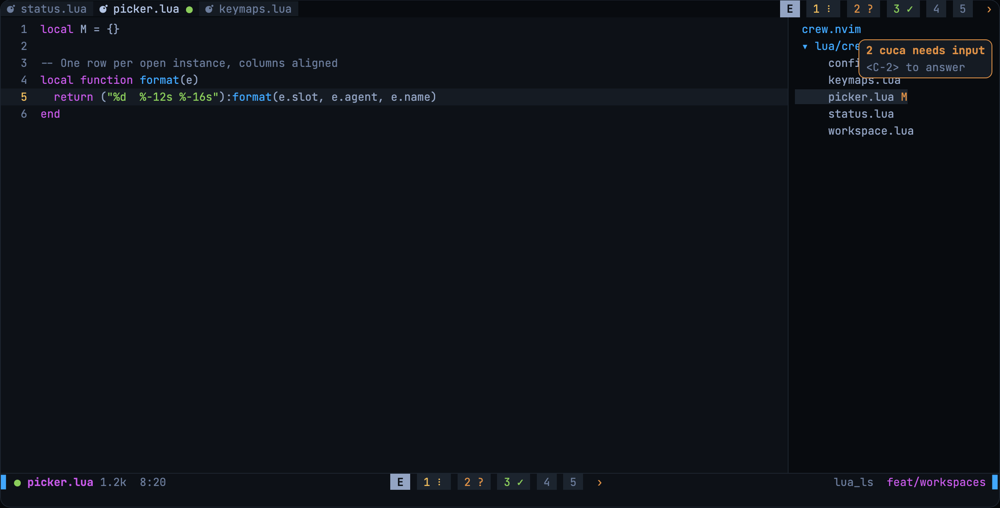
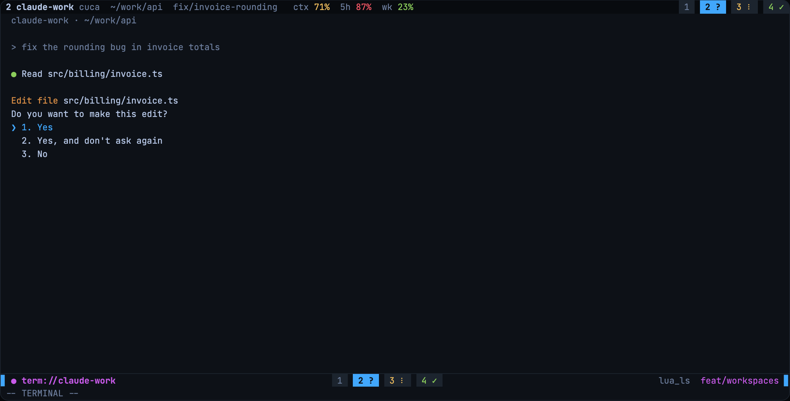
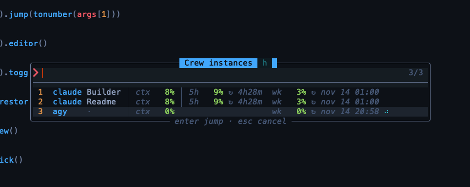

# crew.nvim

Run several AI coding agents inside Neovim with each one in its own tab while always knowing which one needs you. crew treats agents the way a tiling window manager treats desktops, so Claude Code gets the full screen while small pills in your tabline and statusline tell you who is working, who is waiting on an answer and who is done.

crew is opinionated. The defaults reflect one specific workflow (Claude Code, snacks, bufferline and lualine on macOS), but every key, icon and color can be changed or turned off.



## The idea

This section explains why agents live in tabs instead of splits. A split shares its columns with your code, so the agent renders cramped and every resize redraws its interface. A tab gives the agent the whole screen while your editor layout stays untouched in tab 1 where one key brings you back.

Agents are numbered from 1 and the editor stands apart as the `E` pill, which `<C-,>` reaches from any agent. When an instance closes, the ones after it move down, so `<C-3>` always means the third agent you see.

There is no limit on how many agents you open. Only five pills show at a time around the agent you are in, while a bare arrow, `‹` or `›`, marks the hidden ones on each side. Each arrow takes the color of the most urgent agent it hides, so an agent asking for input still blinks when it is out of view.



## Requirements

This section lists what crew needs and what it uses when available.

- Neovim 0.11 or newer
- A terminal with the kitty keyboard protocol (Ghostty, kitty, WezTerm) for `<C-,>` and `<C-1>` to `<C-9>`, since legacy terminals cannot tell those keys apart
- Optional plugins that crew plugs into when present, namely [snacks.nvim](https://github.com/folke/snacks.nvim) for the pickers, [bufferline.nvim](https://github.com/akinsho/bufferline.nvim) and [lualine.nvim](https://github.com/nvim-lualine/lualine.nvim) for the pills

Without snacks the pickers fall back to `vim.ui.select`, which keeps everything usable on a plain setup.

## Installation

The snippet below installs crew with [lazy.nvim](https://github.com/folke/lazy.nvim) and two Claude profiles. Load it eagerly so the lualine component and the hooks are ready when Neovim starts.

```lua
{
  "R4k4210/crew.nvim",
  lazy = false,
  opts = {
    agents = {
      claude = { cmd = { "claude" } },
      ["claude-work"] = {
        cmd = { "claude" },
        env = { CLAUDE_CONFIG_DIR = vim.fn.expand("~/.claude-work") },
      },
    },
  },
}
```

Your `agents` table replaces the default one, so list every profile you want to pick from.

### Claude Code only, for now

Any CLI runs as an agent in its own tab with numbers, pills, jumps and sending files, but several features read what Claude Code exposes and do nothing for other agents yet. The state icons, the usage feed and the sessions picker on `<leader>aN` only work with commands named `claude`. Another CLI can still resume through its own picker when its profile sets `resume`, for example `resume = { "resume" }` for Codex.

## Keys

All keys live under `<leader>a` except the tab switching ones, which need to work from inside a running agent.

| Key | Mode | Action |
|---|---|---|
| `<C-,>` | normal, terminal | Toggle between the editor and the last agent |
| `<C-1>` to `<C-9>` | normal, terminal | Jump to agent N, silently ignored when it is empty |
| `<leader>an` | normal | New instance, picking a profile when there are several |
| `<leader>aN` | normal | New instance that resumes an earlier session, picked from the sessions of the cwd |
| `<leader>ap` | normal | Pick an open instance |
| `<leader>ai` | normal | Name the current instance |
| `<leader>ax` | normal | Close the current instance |
| `<leader>aX` | normal | Close every instance and return to the editor |
| `<leader>af` | normal | Send `@path` of the current file, picking the instance |
| `<leader>aF` | normal | Send the current file to the last instance |
| `<leader>av` | visual | Send the selected lines with their location, picking the instance |
| `<leader>aV` | visual | Send the selection to the last instance |

Leader keys only exist in normal and visual mode because inside an agent your space bar has to reach the agent. Leave terminal mode with `<C-\><C-n>` or with the key you set in `stopinsert`.

### Changing keys

Every entry in `opts.keys` takes a key string or `false` to turn it off. The example below moves the group to `<leader>c` and disables the direct jumps.

```lua
opts = {
  keys = {
    toggle = "<C-,>",
    editor = "<C-0>", -- off by default, since <C-,> already reaches the editor
    new = "<leader>cn",
    close = "<leader>cx",
    close_all = "<leader>cX",
    pick = "<leader>cp",
    rename = "<leader>ci",
    send_file = "<leader>cf",
    send_file_last = "<leader>cF",
    send_selection = "<leader>cv",
    send_selection_last = "<leader>cV",
    jump = false, -- or any format with %d, e.g. "<A-%d>"
    stopinsert = "jk", -- leave terminal mode inside agents
  },
}
```

To map things yourself, set the keys to `false` and call the commands listed below.

### Editor pill and pill window

The editor pill label and the number of visible agent pills are options too.

```lua
opts = {
  editor = { label = "E" }, -- "[E]", "Editor" or an icon
  pills = { max = 5 },      -- agent pills shown around the current one
}
```

## Pickers

crew opens its own snacks pickers with no preview window, so your global picker layout keeps its file preview everywhere else. The instance picker shows the number, profile and name of each instance next to its usage, with a footer listing the keys that work inside it.



Names are optional labels you set with `<leader>ai`. They appear in the picker and never in the pills, which keeps the pills one or two cells wide however long the name is.

## Agent state

Claude Code instances report their state through hooks that crew injects through the `--settings` flag of each Claude agent, so your own `settings.json` is never touched. If your command already passes `--settings`, crew merges its hooks into it and keeps yours.

| Pill | Meaning | Clears when |
|---|---|---|
| `●` | The agent is working | It stops or asks |
| `?` | The agent waits on you, for example a permission prompt | You answer |
| `✓` | The agent finished | You visit its tab |

A waiting agent also blinks its pill and shows a notification when you are in another tab. Each hook runs a small Lua script that talks to Neovim through `$NVIM` and always exits cleanly, so a broken hook can never block Claude.

## Usage meters

Context, five hour and weekly usage come from the Claude Code status line, which crew takes over through the same `--settings` merge. Context belongs to each instance while both limits belong to the profile, so two `claude-work` instances show the same limits.

Only one status line can run per Claude session, so crew chains yours. It finds your own `statusLine` in the agent `--settings` or in the `settings.json` of its config directory (respecting `CLAUDE_CONFIG_DIR`), runs it with the same input and prints its output. Your status bar inside Claude looks exactly as before.

Set `hooks = false` on an agent to turn off both the state hooks and the usage feed for it.

## Pills and the agent header

crew ships thin adapters and leaves the wiring to you, so it never changes another plugin behind your back. Neither bufferline nor lualine is required, so pick the one you already use.

### With bufferline

Pills replace the tab numbers on the right. Inside agent tabs the filter hides your editor buffers and the left area shows a header with the number, profile, name, cwd, branch and usage meters of that agent.

```lua
options = {
  show_tab_indicators = false,
  custom_filter = function(buf)
    return require("crew.bufferline").filter(buf)
  end,
  custom_areas = {
    left = function()
      return require("crew.bufferline").left()
    end,
    right = function()
      return require("crew.bufferline").right()
    end,
  },
}
```

### With lualine

The pills are a native component. Place it after a `%=` split to center it.

```lua
sections = { lualine_c = { "crew" } }
```

Lualine has no room for the agent header, so turn on `header = "winbar"` in the crew options. The header then shows at the top of each agent window, where a narrow window cuts the cwd before it cuts the agent name.

### Highlight groups

Every color comes from a group linked to a standard one with `default = true`, so crew follows your colorscheme and any `nvim_set_hl` call of yours wins.

- Agent pills use `CrewPill`, `CrewPillCurrent`, `CrewPillWork`, `CrewPillAsk`, `CrewPillAskBlink` and `CrewPillDone`
- The editor pill uses `CrewPillEditor` and `CrewPillEditorCurrent`, while the hidden agent arrows use `CrewPillMore` when nothing they hide has a state
- The header uses `CrewHeader` for the number and profile, `CrewHeaderName` for the name and `CrewHeaderDim` for the cwd, branch and labels

Brightening the dim header text takes one line in your config.

```lua
vim.api.nvim_set_hl(0, "CrewHeaderDim", { fg = "#6c7d9c" })
```

## Commands

Everything the keys do is also available as a subcommand of `:Crew`, which helps when you prefer your own mappings.

```
:Crew open [profile]   :Crew new        :Crew pick
:Crew jump N           :Crew toggle     :Crew close [N]
:Crew rename [name]    :Crew editor     :Crew list
:Crew close all        :Crew resume [profile]
:Crew restore
```

### Restoring agents after a restart

crew remembers the open agents of each directory and saves them on every change, so even a killed terminal keeps the list. When any session manager loads a session (persistence.nvim, the snacks dashboard "Restore Session", a plain `:source`), crew reopens them in the same order with the same names. `:Crew restore` does the same by hand. Claude agents resume their own conversation with `claude --resume <id>`, while other agents start fresh. `<leader>aX` closes every agent and forgets them, so they stay closed after a restart.

crew expects one Neovim per directory, since all its agents live as tabs of that one instance. Two Neovim instances open in the same directory share one restore file, so the one that saves last decides what comes back.

## Status

crew is young and changes often. Run `:checkhealth crew` when something looks off and read `:help crew` for every option. `make test` runs the mini.test suite, which clones its own dependencies into `deps/`.

## Mockup

[docs/mockup.html](docs/mockup.html) is an interactive mockup of the whole workflow drawn within what a terminal grid can show. Open it in a browser and use the keys listed on the page.
